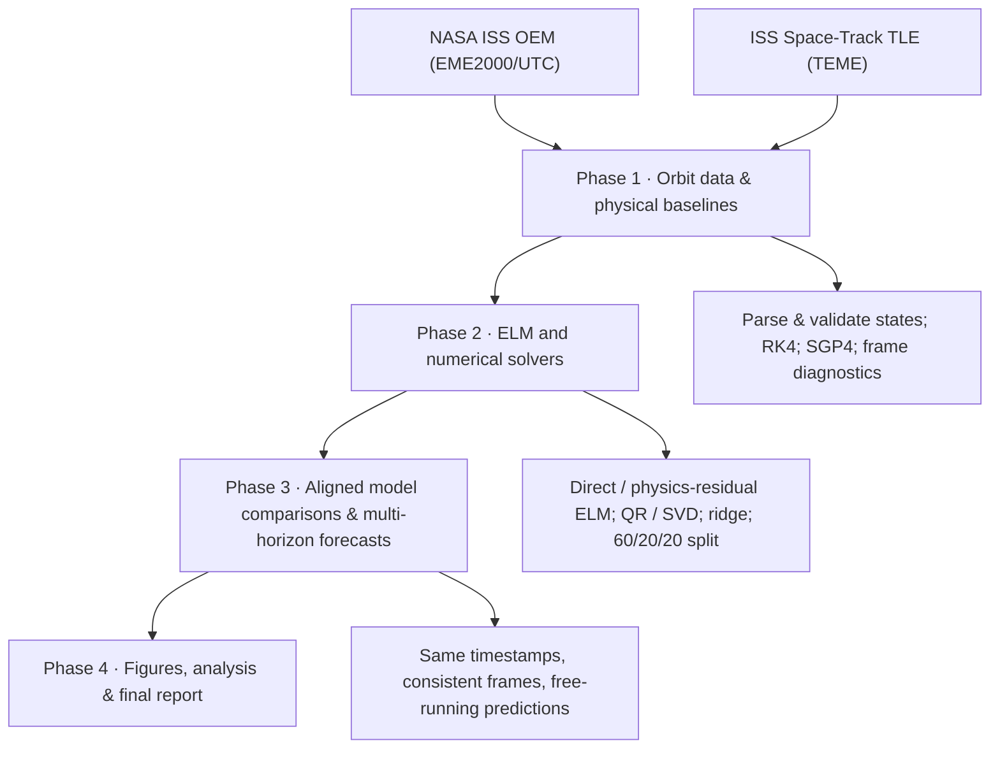
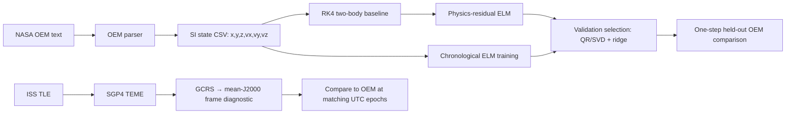
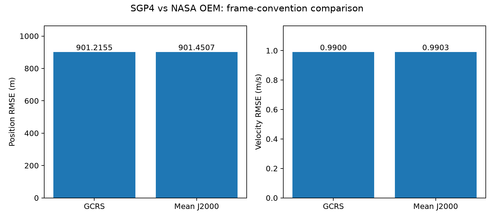
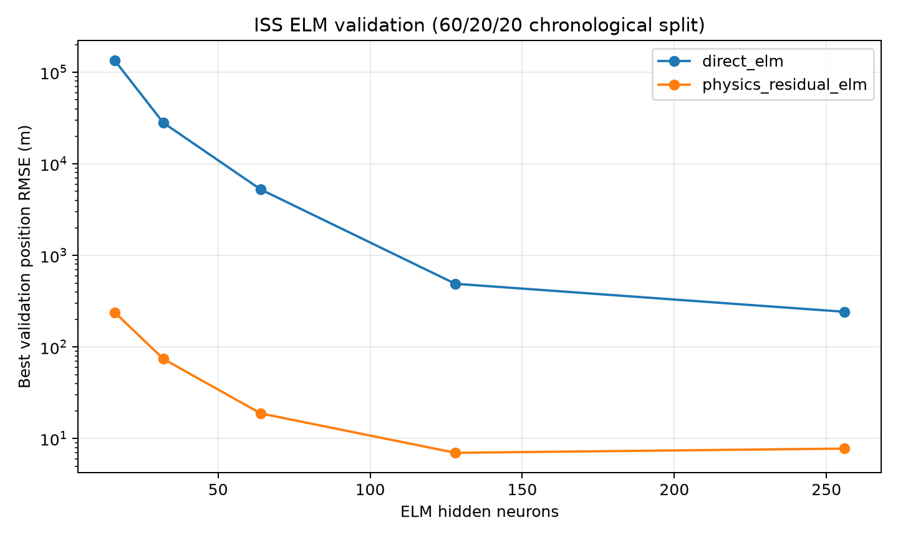
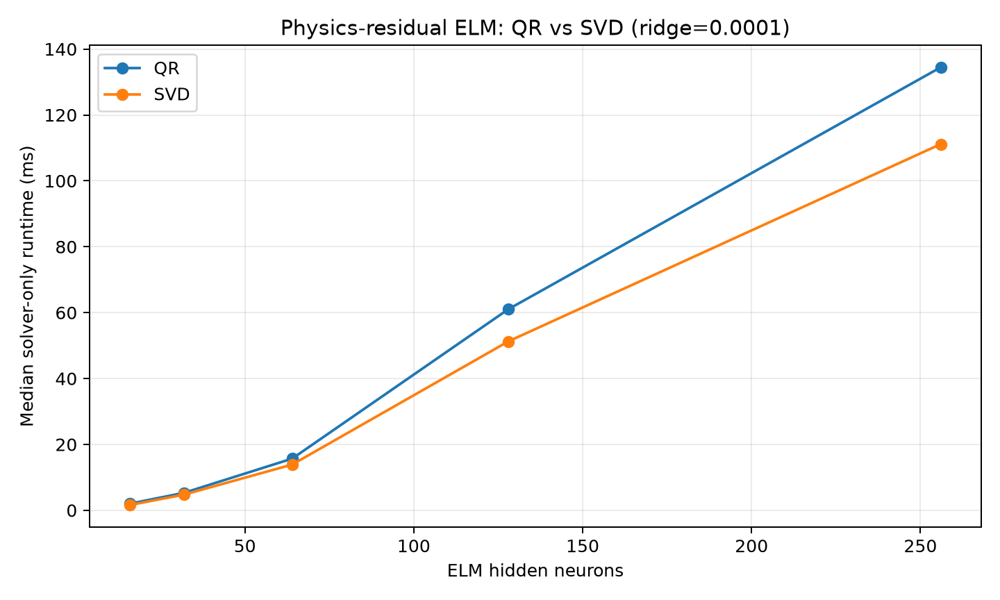

# ISS Satellite State Prediction — Numerical Methods and Physics-Informed ELM

Reproducible numerical study of **International Space Station (ISS, NORAD 25544)** orbital-state prediction using NASA operational ephemerides, a two-body Runge–Kutta baseline, SGP4/TLE propagation, and Extreme Learning Machines (ELMs). The project investigates how **QR versus SVD least-squares solvers**, ridge regularization, and physics-informed residual learning affect accuracy, conditioning and computational cost.

> **Project dependency file:** [`requirements-project.txt`](requirements-project.txt). The root `requirements.txt` and `src/satellite_model*.py` belong to an earlier orbit-determination workflow and are retained for legacy use.

## Project roadmap



| Phase | Goal | Current status |
| --- | --- | --- |
| **1 — Data and baselines** | Parse NASA OEM, run RK4 and SGP4, check epochs and coordinate frames | **Implemented; final data-quality and exact OEM frame-realization checks remain** |
| **2 — Numerical learning** | Train direct and physics-residual ELMs; compare QR/SVD, ridge and conditioning | **Implemented; validation and repeated solver benchmarks recorded** |
| **3 — Forecast evaluation** | Fair, same-epoch SGP4/RK4/ELM comparisons; multiple open-loop horizons | **Pending comprehensive evaluation** |
| **4 — Reporting** | Consolidated plots, tables, limitations and reproducible report | **Pending** |

The detailed verification plan is in [`docs/PROJECT_PLAN.md`](docs/PROJECT_PLAN.md).

## Data and model flow



NASA OEM is an **operational ephemeris**, not independent raw-measurement ground truth. OEM declares **EME2000**, while SGP4 returns **TEME**. The frame diagnostic uses Astropy TEME→GCRS and ERFA IAU 2000 frame bias to mean-J2000; exact agreement with the OEM provider's EME2000 realization remains unverified.

## Installation

From the repository root, with Python 3.10+ recommended:

```bash
git clone https://github.com/tanerjn/satnav.git
cd satnav
python -m venv .venv
source .venv/bin/activate              # Windows: .venv\\Scripts\\activate
python -m pip install -r requirements-project.txt
PYTHONPATH=src python -m unittest discover -s tests -v
```

On Windows PowerShell, set `$env:PYTHONPATH="src"` and then run `python scripts/...py` instead of prefixing each command with `PYTHONPATH=src`.

## Quick start: run experiments in order

The commands below assume the tracked/source OEM file `data/iss/nasa_oem/ISS.OEM_J2K_EPH.txt` and ISS TLE `data/iss/spacetrack/iss.tle` exist locally. Run them from the repository root.

### Phase 1 — Prepare data and verify physical baselines

**1. Parse the NASA OEM into meters and meters/second.**

```bash
PYTHONPATH=src python scripts/check_iss_oem_metadata.py \
  --oem data/iss/nasa_oem/ISS.OEM_J2K_EPH.txt

PYTHONPATH=src python scripts/prepare_iss_dataset.py \
  --oem data/iss/nasa_oem/ISS.OEM_J2K_EPH.txt
```

Output: `data/iss/processed/nasa_iss_states.csv` with `epoch_utc,x_m,y_m,z_m,vx_mps,vy_mps,vz_mps`.

**2. Run RK4 and the exploratory one-step sensitivity experiment.**

```bash
PYTHONPATH=src python scripts/iss_experiments.py \
  --hidden 64 --output results/iss/phase1_check
```

Output: `results/iss/phase1_check/iss_sensitivity.csv` and `experiment_metadata.json`. The baseline evaluates the next state **240 seconds** after each observed input state. This is *teacher-forced one-step evaluation*, not free-running orbit prediction.

**3. Run SGP4 against overlapping OEM epochs (±2 days from the TLE).**

```bash
PYTHONPATH=src python scripts/compare_iss_sgp4.py \
  --tle data/iss/spacetrack/iss.tle --max-age-days 2
```

This uses a single TLE and compares SGP4 after TEME→GCRS conversion with the OEM states. The result is exploratory until the exact OEM frame realization is verified.

**4. Quantify the GCRS versus mean-J2000 frame-bias effect.**

```bash
PYTHONPATH=src python scripts/verify_iss_frames.py \
  --tle data/iss/spacetrack/iss.tle \
  --max-age-days 2 \
  --output results/iss/phase1/frame_verification.json
```

This reports the RMS/max frame differences and SGP4/OEM RMSE under both conventions. It does **not** certify exact OEM frame equivalence.



*Phase 1 frame diagnostic: RMSE against NASA OEM under two frame conventions. The exact OEM EME2000 realization is not independently certified.*

### Phase 2 — Validate ELMs and benchmark numerical solvers

**5. Select hyperparameters chronologically (60% train / 20% validation / 20% test).**

```bash
PYTHONPATH=src python scripts/iss_validate.py \
  --hidden 16 32 64 128 256 \
  --ridge 0 0.000001 0.0001 0.01 1 100
```

Output: `results/iss/validated/validation_grid.csv` and `selected_model_test.json`. The validation segment selects architecture, hidden size, ridge coefficient and QR/SVD solver; the selected configuration is refitted on the first 80% before the final 20% test. The test measures **one-step agreement with NASA OEM**, not independent future forecasting.



*Validation-set position RMSE across hidden sizes and model families; these are not final held-out test errors.*

**6. Benchmark QR versus SVD on the same fixed ELM hidden-feature matrices.**

```bash
PYTHONPATH=src python scripts/benchmark_iss_solvers.py \
  --hidden 16 32 64 128 256 \
  --ridge 0 0.000001 0.0001 0.01 1 \
  --warmups 2 --repeats 7
```

Output: `results/iss/solver_benchmark/solver_benchmark.csv` and `benchmark_metadata.json`. Timing measures **solver-only** time, excluding feature construction and orbital propagation.



*Median QR and SVD solver-only runtimes for the physics-residual ELM (ridge λ = 0.0001); excludes feature construction.*

### Generate plots

```bash
PYTHONPATH=src python scripts/plot_iss_results.py
```

The plotting script reads existing outputs (it does not retrain models) and writes available figures to `results/iss/figures/`:

| Figure | Input | What it shows |
| --- | --- | --- |
| `validation_position_rmse.png` | `validation_grid.csv` | Best *validation* position RMSE per ELM family and hidden size |
| `solver_runtime.png` | `solver_benchmark.csv` | Median QR vs SVD solver-only runtime at ridge λ = 0.0001 |
| `frame_comparison.png` | `frame_verification.json` | SGP4/OEM RMSE using GCRS versus mean-J2000 conventions |

Missing input files are skipped with a message. Generated images can be committed later if a static GitHub README gallery is desired.

## What we measure

| Measurement | Definition / interpretation |
| --- | --- |
| **Position RMSE (m)** | Square root of mean squared Euclidean 3D position error at aligned epochs |
| **Velocity RMSE (m/s)** | Same metric for 3D velocity |
| **Validation/test performance** | One-step 240-second teacher-forced agreement with NASA OEM |
| **Frame differences** | RMS/max difference between GCRS and mean-J2000 Cartesian states |
| **QR/SVD solver runtime (ms)** | Median, min, max and standard deviation over repeated solver-only calls |
| **Numerical stability** | Hidden-matrix condition number and numerical rank |
| **Least-squares fit** | Frobenius residual norm, coefficient norm and ridge objective |
| **Solver consistency** | Frobenius norm of QR minus SVD fitted coefficients |
| **Multi-horizon forecast errors** | Planned Phase 3 evaluation; distinct from one-step metrics |

The ridge objective is `||Hβ − Y||²_F + λ||β||²_F`. Training features and targets are normalized using training-only statistics.

## Recorded experimental results

These numbers come from recorded project runs; **they are not a controlled head-to-head comparison across all methods** because some experiments use different time subsets or splits.

| Experiment | Position RMSE | Velocity RMSE | Context |
| --- | ---: | ---: | --- |
| Two-body RK4 | 377.616 m | 3.050 m/s | Earlier 70/30 one-step test |
| Physics-residual ELM (64 neurons, no ridge) | 43.177 m | 0.354 m/s | Earlier 70/30 one-step test |
| Physics-residual ELM (128 neurons, λ=1e-4, QR) | **7.352 m** | **0.06067 m/s** | Chronological 60/20/20 validation-selected final test |
| SGP4 (Nov 11 Space-Track TLE), GCRS vs OEM | 901.215 m | 0.990036 m/s | 1,381 overlapping OEM epochs, ±2-day TLE age |
| SGP4, mean-J2000 frame-bias correction vs OEM | 901.451 m | 0.990305 m/s | Same 1,381 epochs; exact OEM realization unverified |

For the frame experiment, the **GCRS-to-mean-J2000 position RMS difference was 0.583 m** (maximum 0.764 m), versus approximately 901 m SGP4/OEM RMSE. This shows the *tested frame-bias rotation* is small relative to the observed discrepancy; it does not rule out other reference-frame, timing, force-model or TLE-age effects.

The validation-selected ELM configuration used 128 hidden neurons, ridge λ=0.0001 and QR; validation position RMSE was 6.995 m. The prior 43 m ELM result used a different split and neuron count, so the change cannot be attributed to ridge alone.

## Repository guide

```text
data/iss/
  nasa_oem/             NASA OEM text ephemeris
  spacetrack/iss.tle    ISS Space-Track TLE snapshot
  celestrak/            Other TLE snapshots
  processed/            Parsed OEM states in SI units
src/satnav/
  dynamics.py           Two-body dynamics and RK4
  iss_oem_parser.py     OEM state ingestion
  oem_metadata.py       OEM header checks
  iss_sgp4.py           SGP4 TEME propagation
  iss_frames.py         TEME→GCRS and GCRS→mean-J2000
  elm_model.py          Extreme Learning Machine
  least_squares.py      QR/SVD with optional ridge
  evaluation.py         3D position/velocity RMSE
scripts/
  prepare_iss_dataset.py
  check_iss_oem_metadata.py
  iss_experiments.py
  compare_iss_sgp4.py
  verify_iss_frames.py
  iss_validate.py
  benchmark_iss_solvers.py
  compare_iss_aligned.py
  plot_iss_results.py
results/iss/
  validated/            Model selection and test results
  solver_benchmark/     QR/SVD timing and stability results
  phase1/               Frame-verification output (when run)
  figures/              Generated plots (when run)
docs/PROJECT_PLAN.md    Detailed phase plan and acceptance checks
requirements-project.txt
```

## Scientific caveats and next work

1. **Phase 1:** Verify the exact OEM EME2000 realization and complete dataset-quality checks; characterize error versus TLE age.
2. **Phase 2:** Numerical benchmark and chronological model selection have been run, but an independent temporal holdout remains important for strong generalization claims.
3. **Phase 3:** Use `scripts/compare_iss_aligned.py` only when a TLE overlaps the **final test epochs**. The November 11 TLE does **not** overlap the November 21–24 final test subset; do not extend TLE age arbitrarily. Add multi-horizon open-loop experiments with identical evaluation windows.
4. **Phase 4:** Consolidate reproducible figures, controlled comparisons, assumptions and limitations into the final report.

**Do not compare** the 7.352 m ELM final-test number directly against the 901 m SGP4 exploratory number as a ranking of predictive accuracy: their evaluation epochs and prediction setups differ.

## Legacy code

The repository also retains an earlier LEO orbit-determination exercise using range residuals and Householder QR in `src/satellite_model.py`. It is separate from the current ISS-first ELM state-prediction study. Use `requirements-project.txt` and the `scripts/` commands above for the current project.
